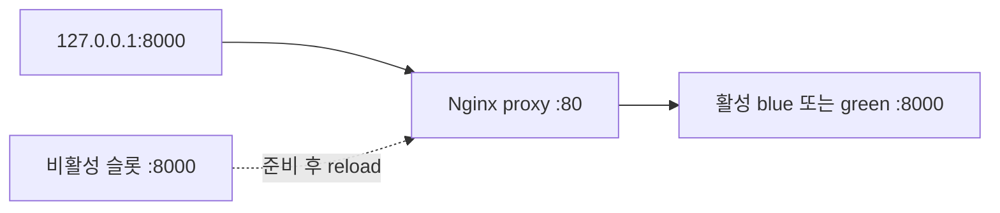

# Windows 로컬 CD / Blue-Green

실제 저장소는 `.git`이 있는 upload 폴더입니다. 아래 명령은 모두 이 폴더에서 실행합니다. CD는 `.github/workflows/cd.yml`, 구현은 `deploy/Deploy.ps1`, 설정은 `deploy/nginx.conf.template`입니다.

## 구조



- 프록시 `kakao-chat-proxy`만 `127.0.0.1:8000:80`을 게시합니다.
- `kakao-chat-blue`, `kakao-chat-green`은 `kakao-chat-net` 내부 8000만 사용합니다.
- Nginx는 공식 `nginx:1.28.0-alpine`, 앱은 기존 Python/FastAPI 이미지입니다.
- Nginx 설정은 named volume `kakao-chat-nginx-config`에 저장하며 docker cp로 전달합니다. Windows 경로를 컨테이너에 bind mount하지 않습니다.
- 앱/프록시는 restart unless-stopped를 사용합니다. Docker Desktop이 실행돼 있어야 합니다.

## 실행 조건과 버전

CI **CI - Test and publish Docker image**의 workflow_run completed를 받습니다. 성공/완료, push, main, 현재 저장소 소유 CI만 허용합니다. GitHub API로 CI 경로·이름·SHA·run number를 재확인하고 main head도 checkout 전과 전환 전에 대조합니다. 배포된 run number보다 오래된 실행은 건너뜁니다.

버전은 **github.event.workflow_run.head_sha**입니다. CD 자신의 github.sha나 latest를 사용하지 않습니다. `<DOCKERHUB_USERNAME>/kakao-chat-analyzer:sha-<전체 SHA>`의 manifest를 확인하고 pull한 뒤 RepoDigest로 실행합니다. /health의 버전도 일치해야 합니다.

GitHub concurrency와 PC의 FileShare.None 잠금을 사용하며 실행 중 배포를 자동 취소하지 않습니다. 같은 버전이 정상 서비스 중이면 전체 프록시 검증 후 NO-OP입니다. main이 준비 중 바뀌면 현재 라우팅을 유지하고 중단합니다. 원격 GitHub와 로컬 사이의 완전한 원자성은 없으므로 마지막 검사 직후의 main 변경은 가능하지만 이후 최신 성공 CI가 다시 배포됩니다.

## Runner / 첫 배포 전

- 기본 라벨 self-hosted, Windows, X64를 사용합니다. 여러 Runner가 있다면 해당 PC 전용 라벨을 runs-on에 추가하세요.
- 기존 Runner를 재설치하지 않습니다. Node 24 action을 지원하는 버전인지 확인하세요(공식 최소 runner v2.327.1 이상).
- Runner를 실행한 동일 Windows 계정이 Docker Desktop Linux Engine에 접근해야 합니다. 자동 관리자 권한 상승은 하지 않습니다.
- PowerShell 정책을 영구 변경하지 않습니다. `.ps1` 차단 시 `Get-ExecutionPolicy -List`로 확인하고 조직 정책에 맞게 운영자가 실행 허용을 결정해야 합니다. GitHub가 생성한 단계와 Deploy.ps1 모두 실행 가능해야 합니다.
- main이 기본 브랜치이고 CD 파일이 그 브랜치에 있어야 합니다. PR/fork 코드는 로컬에서 실행하지 않습니다. main 쓰기 권한을 제한하고 branch protection을 사용하세요.
- 기존 DOCKERHUB_USERNAME, DOCKERHUB_TOKEN만 유지합니다. GitHub 조회에는 job의 자동 github.token을 사용하며 새 PAT/Runner 등록 토큰은 필요하지 않습니다.

```powershell
docker info --format '{{.OSType}}'
docker ps --format 'table {{.Names}}\t{{.Ports}}'
Get-NetTCPConnection -LocalPort 8000 -State Listen -ErrorAction SilentlyContinue
```

포트 조회가 권한으로 차단되면 `netstat -ano | findstr :8000`을 사용하세요. 다른 프로세스가 8000을 점유하면 초기 CD는 실패하며 임의로 중단하지 않습니다. 기존 단일 컨테이너를 처음 Nginx로 이전하는 작업은 운영자가 점유자를 확인하고 계획해야 합니다.

## 최초 배포

1. 엔진/CI/main/상태/소유권/포트를 확인합니다.
2. 임시 DOCKER_CONFIG로 로그인합니다. 토큰은 password-stdin으로 전달하고 출력하지 않습니다. job 종료 시 runner.temp의 해당 job 디렉터리만 경로 확인 후 삭제합니다. 기본 Docker 인증은 변경하지 않습니다.
3. 관리 라벨이 있는 네트워크·볼륨을 만들고 manifest 확인·pull합니다.
4. blue 앱을 내부 네트워크에 실행합니다. 앱 안의 실제 /health가 200/status/version 확인을 3회 연속 통과해야 합니다(최대 30회, 간격 2초).
5. 임시 Nginx 검사 컨테이너에서 nginx -t 후 설정을 볼륨에 반영합니다. 검사 컨테이너만 제거합니다.
6. 프록시를 처음 실행하고 호스트에서 health, 홈, docs, OpenAPI, 정적 자산, 합성 분석 API를 검증합니다.
7. 15초 안정성을 확인한 후 상태를 기록합니다. 첫 배포 실패에는 구버전이 없으므로 롤백 성공으로 보고하지 않습니다.

## 후속 배포

1. 프록시 설정 슬롯/버전과 실제 /health를 대조합니다. 불일치하면 추측해 전환하지 않고 실패합니다.
2. 이전 reload worker가 남아 있으면 drain부터 기다립니다. 안전 확인 전에는 비활성 슬롯도 제거하지 않습니다.
3. 활성 앱을 유지한 채 비활성 슬롯의 이 저장소 소유 컨테이너만 대체합니다.
4. 신규 앱 준비 후 main을 다시 확인합니다. 후보 설정을 별도 경로에 복사하고 nginx -t 성공 후 최종 경로로 원자적 mv합니다.
5. nginx -s reload로 전환합니다. 프록시는 재시작/재생성하지 않습니다.
6. 새 버전의 프록시 응답·API·안정성을 검증합니다.
7. 전환 전 worker PID 종료를 최대 75초 기다립니다. 강제 worker 종료 시간을 설정하지 않습니다. drain 실패 시 구버전 복구를 시도하고 두 앱을 보존합니다.
8. 이전 앱은 running으로 보관하고 다음 배포의 슬롯 재사용 때만 제거합니다. 앱은 최대 두 슬롯입니다. 전역 prune과 이미지 자동 삭제는 하지 않습니다.

PC 전원 종료나 강제 job 종료로 설정·실제 라우팅·상태가 어긋나면 다음 실행은 이를 감지해 실패합니다. 임의로 구버전을 삭제하지 않으며 운영자 조사/복구가 필요합니다. 모든 장애의 자동 복구를 보장하는 시스템은 아닙니다.

## 상태와 롤백

상태 경로는 Runner 계정 `%LOCALAPPDATA%\kakao-chat-analyzer-deploy`이며 checkout과 독립적입니다. lock/state.json과 후보/롤백 설정만 보관하고 대화·토큰은 저장하지 않습니다. 한 PC/프로젝트에는 하나의 Runner 계정·상태 경로를 사용하세요.

| 실패 | 동작 |
| --- | --- |
| 로그인/manifest/pull | 활성 서비스 유지, job 실패 |
| 후보 실행/준비 | 전환 안 함, 전환 안 된 후보만 정리 |
| Nginx 설정 | 이전 설정 복원·검증, 기존 라우팅 유지 |
| 전환 후 버전/API/안정성/drain | 이전 설정 검증·reload·구버전 HTTP 확인, job 실패 유지 |
| 롤백 실패 | 두 앱 보존, 실패 로그, 운영자 복구 |
| 소유권 충돌 | 다른 리소스를 수정/삭제하지 않고 실패 |

전환 후 실패한 후보도 drain/조사를 위해 보존하고 다음 배포가 안전 확인 후 정리합니다. 수동 코드 롤백은 main에 되돌림/수정 커밋을 올려 새 CI SHA를 만드는 방식이 권장됩니다. 오래된 CI 재실행으로 최신 버전을 덮어쓰지는 않습니다.

## 검증 / 로그

제공받은 기존 이미지의 수동 Pull 명령입니다. 자동화에는 이 SHA를 고정하지 않습니다.

```powershell
docker pull sany19/kakao-chat-analyzer:sha-0f7d9acdcaf65a8fecb5f7fd94e71538d668dc1a
```

이전 이미지의 /docs 상태는 미확인입니다. 이번 변경 전 코드로 만든 이미지라면 새 요구와 다를 수 있으므로 이번 소스로 CI가 만든 새 SHA 이미지로 최종 CD를 검증하세요.

```powershell
Invoke-RestMethod http://127.0.0.1:8000/health
(Invoke-WebRequest -UseBasicParsing http://127.0.0.1:8000/).StatusCode
(Invoke-WebRequest -UseBasicParsing http://127.0.0.1:8000/docs).StatusCode
docker ps --filter 'label=io.kakao.deploy.repository=<owner>/<repo>'
docker network inspect kakao-chat-net
docker exec kakao-chat-proxy nginx -t -c /etc/nginx/managed/nginx.conf
docker logs --tail 100 kakao-chat-proxy
```

브라우저에서 http://127.0.0.1:8000/ 및 http://127.0.0.1:8000/docs 를 확인하세요. 실제 원문 대신 가상 데이터를 사용하세요. 장시간 연결/부하 중 무중단 여부와 실제 Docker reload는 미검증입니다.

모의 테스트는 Docker/GitHub/HTTP를 대체합니다. 사용자가 테스트 프로세스에만 허용한 명령:

```powershell
powershell.exe -NoProfile -ExecutionPolicy Bypass -File .\deploy\Test-Deployment.ps1
```

실제 배포에 이 플래그를 자동 적용하지 않았으며 시스템/사용자 정책도 바꾸지 않았습니다. 모의 성공은 엔진·Nginx 검증을 대체하지 않습니다.

Actions에서 CI 후 **CD - Local Windows Blue-Green deployment**의 guard, 엔진 접근, 로그인, 배포와 READY/DEPLOYED/ROLLED BACK/SKIP/NO-OP 로그를 확인하세요. 실패 진단은 원래 실패를 성공으로 바꾸지 않습니다. 성공 시 /health 버전·CI head_sha·상태 파일·Docker Hub 태그가 같아야 합니다.

## 직접 GitHub 반영

현재 브랜치를 확인한 뒤 직접 main에 반영하세요. 도구는 Git 명령을 실행하지 않았습니다.

```powershell
git status
git branch --show-current
git add .github/workflows/cd.yml deploy app/main.py static .dockerignore .gitignore tests README.md CD_VALIDATION.md
git diff --cached --stat
git diff --cached
git commit -m "Add Windows local blue-green deployment after successful CI"
git push origin main
```

Runner 인증 파일, .deploy-state, .venv, 원문이 staged 목록에 없는지 확인하세요. 비밀번호나 Runner 등록 파일은 추가하지 않습니다.
